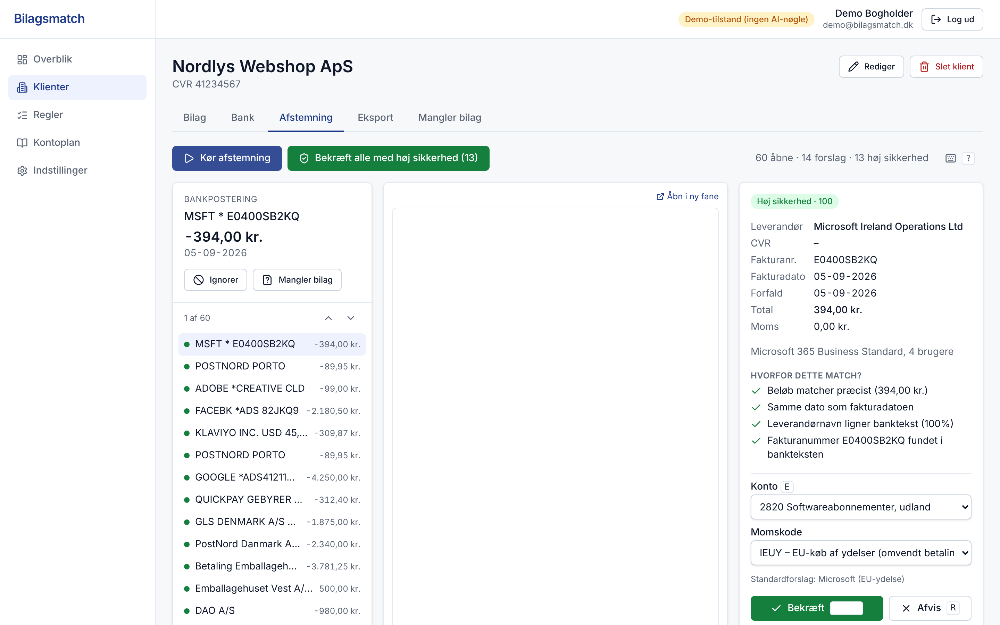
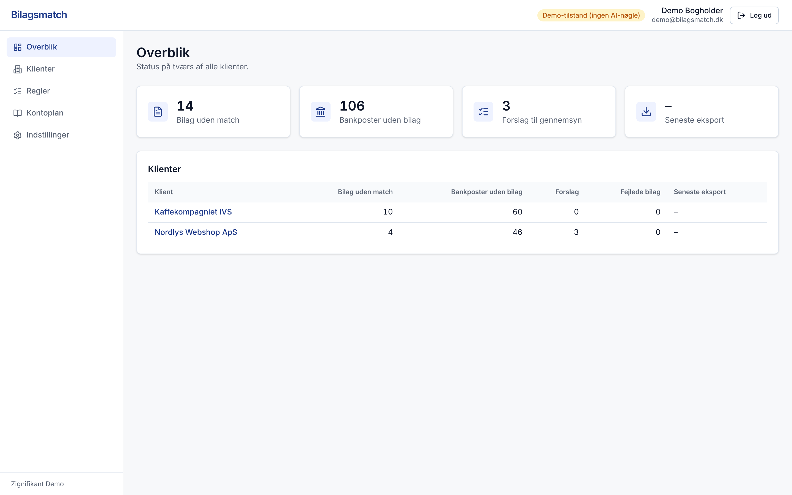
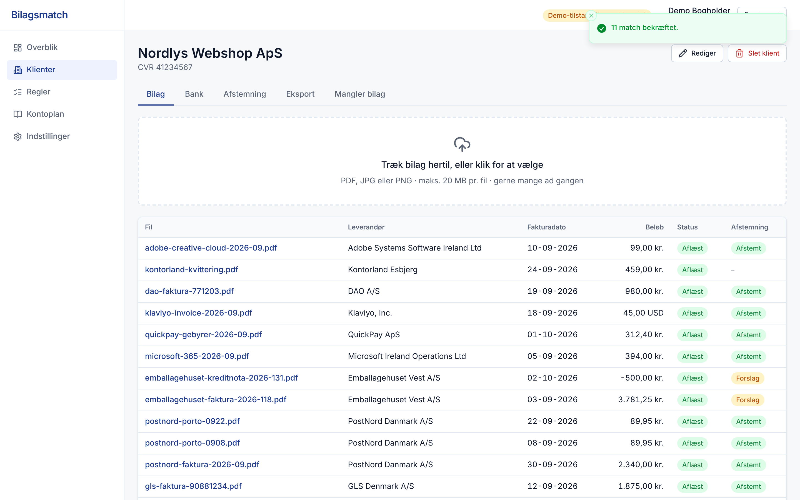
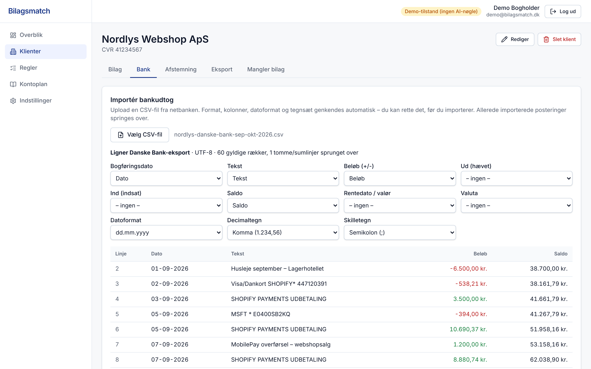
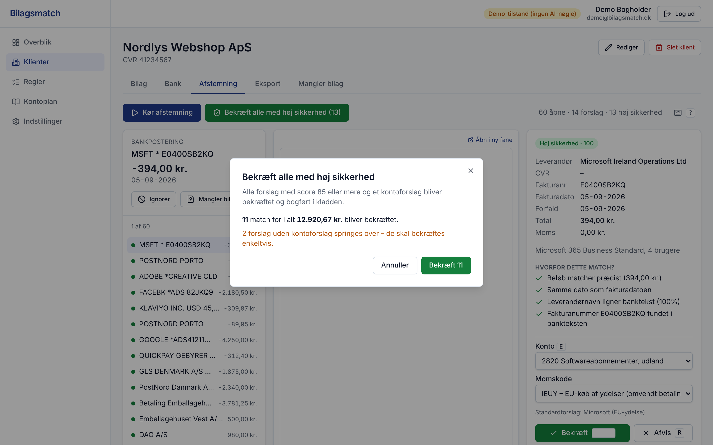
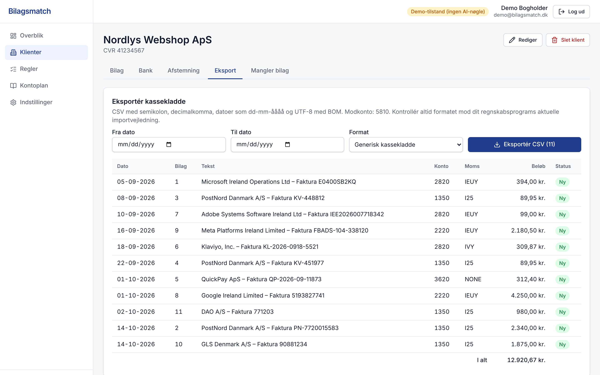
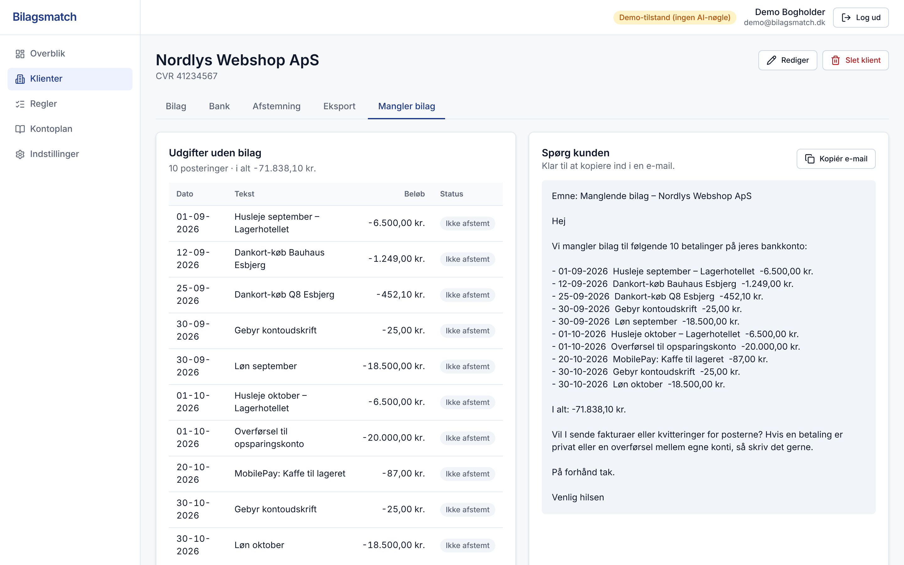

# Bilagsmatch

Bilagsmatch matches receipts and invoices (_bilag_) to bank transactions for Danish bookkeepers. It reads each document with AI, imports bank statements from Danish banks as CSV, suggests matches with explanations, and suggests the ledger account and VAT code. It learns from the bookkeeper's confirmations and exports a journal (_kassekladde_) CSV for e-conomic, Dinero or Billy.

It was built as an MVP for small bookkeeping firms that serve webshops (e.g. Zignifikant). The UI is in Danish. Code and docs are in English.



## Setup in 5 commands

Requires Node.js 20.9 or newer (developed with Node 22).

```bash
npm install
cp .env.example .env
npm run db:reset      # create the SQLite database, run migrations and seed demo data
npm run build
npm run start         # or: npm run dev
```

Open http://localhost:3000 and log in as **demo@bilagsmatch.dk / demo1234**.

`npm run db:reset` deletes and rebuilds the local database. On a brand-new checkout without a database you can also use `npx prisma migrate deploy && npm run db:seed`.

### Two-minute demo

1. Log in. The dashboard shows two demo clients with documents and bank transactions already imported.
2. Click **Nordlys Webshop ApS**. This opens the _Afstemning_ tab.
3. Click **Kør afstemning**: 14 suggestions appear, 13 of them marked _Høj sikkerhed_. The Shopify invoice in USD is marked _Tjek venligst_ and explains the currency difference.
4. Review with the keyboard: `Enter` confirms, `R` rejects, `J`/`K` moves between items, `M` opens manual matching, `?` shows all shortcuts. Or click **Bekræft alle med høj sikkerhed**.
5. Open **Eksport**, choose _e-conomic-kompatibel_ and click **Eksportér CSV**.
6. Open **Mangler bilag** to see expenses with no receipt and a ready-to-send email to the client.

The demo PDFs and bank CSVs are also written to `storage/demo-files/`, so you can drag them into a new client yourself.

## Screenshots

|                                                                                            |                                                                             |
| ------------------------------------------------------------------------------------------ | --------------------------------------------------------------------------- |
|  Dashboard                                                |  Documents with extraction status                |
|  CSV import with detected format and column mapping |  Bulk confirm with count and total         |
|  Journal export preview                                     |  Missing receipts and email text |

Screenshots are made by `npm run docs:screenshots`. Headless Chromium has no PDF viewer, so the PDF preview pane is blank in the screenshots. In a normal browser it shows the document.

## Scripts

| Script                                | What it does                                                                                                                     |
| ------------------------------------- | -------------------------------------------------------------------------------------------------------------------------------- |
| `dev` / `build` / `start`             | Next.js dev server / production build / production server                                                                        |
| `typecheck`                           | `tsc --noEmit` (strict)                                                                                                          |
| `lint` / `format`                     | ESLint (zero warnings allowed) / Prettier                                                                                        |
| `test`                                | Vitest unit and integration tests, run against a throwaway SQLite database (`prisma/test.db`). Add `-- --coverage` for coverage. |
| `test:e2e`                            | Playwright: builds the app and starts it on port 3100 with a fresh seeded `prisma/e2e.db`, then runs the browser tests           |
| `db:migrate` / `db:seed` / `db:reset` | Prisma migrate dev / seed demo data / delete the database, re-migrate and seed                                                   |
| `demo:check`                          | Prints the matches the engine finds in the seeded demo data (read-only)                                                          |
| `docs:screenshots`                    | Regenerates `docs/*.png`                                                                                                         |

## Enabling real AI extraction

By default the app runs in **Demo-tilstand**. A deterministic mock provider "reads" documents offline. It returns correct data for the 25 sample PDFs. For other files it guesses from the filename (supplier words, a date or an amount in the name) with low confidence.

To use Claude:

```bash
# .env
ANTHROPIC_API_KEY="sk-ant-..."
ANTHROPIC_MODEL="claude-sonnet-5-5"   # optional; this is the default
```

Restart the server. The header badge changes to _AI aktiv_, and **Indstillinger** shows the model in use.

How the real provider works (`src/lib/extraction/anthropic-provider.ts`):

- PDFs are sent as `document` content blocks and images as `image` blocks. A Danish system prompt explains Danish invoice conventions (Moms, I alt, Fakturanr., CVR-nr., Forfaldsdato, number and date formats, 25 % VAT, credit notes, reverse charge).
- The response is constrained to a JSON schema (structured output) and then **validated with Zod**. If validation fails, the request is retried once with the validation errors included in the prompt. If it fails again, the document is marked `FAILED` with a readable Danish message.
- Rate limits, 5xx errors, timeouts and connection errors are retried with exponential backoff (1 s, 2 s, 4 s; at most 3 retries). After that the job queue retries the job later, up to 3 attempts in total.
- Password-protected PDFs are rejected before calling the API. Files over 20 MB are rejected in the browser and again on the server.
- After extraction, sanity checks add warnings to the document (they never block): net + VAT ≈ total (±1 kr.), and VAT ≈ 20 % of the total.

Extraction runs in a **DB-backed job queue**. Uploads return immediately and the UI polls for status. The queue is processed by an in-process worker that starts with the server (`src/instrumentation.ts`, 3 jobs at a time). Jobs locked by a dead worker are picked up again after 5 minutes. Set `EXTRACTION_WORKER_ENABLED=false` to disable the worker.

## Bank CSV import

`src/lib/bank-csv/` auto-detects:

- encoding: UTF-8, UTF-8 with BOM, and Windows-1252 / ISO-8859-1 (æøå preserved)
- delimiter: `;`, `,` or tab, including quoted fields that contain the delimiter
- decimal comma (`1.234,56`) or decimal point (`1234.56`), per file
- date format: `dd-mm-yyyy`, `dd.mm.yyyy`, `dd/mm/yyyy`, `yyyy-mm-dd` (and `dd-mm-yy`)
- the header row, even after preamble lines, using Danish header synonyms (Dato, Bogføringsdato, Rentedato, Valør, Tekst, Beskrivelse, Beløb, Saldo, Valuta, Ud/Ind, Hævet/Indsat …). Files without a header are mapped from their content.
- either one signed amount column or separate _Ud_/_Ind_ columns
- empty and summary lines ("Saldo pr. …", "I alt"), which are skipped

The preview shows the first 10 parsed rows and the column mapping. The mapping can be changed with dropdowns before importing. After import the app reports rows imported, rows skipped as duplicates and rows that failed, with the line number and reason for each failure. Re-importing the same file creates no duplicates. Each row gets a hash of date, amount, text and balance, plus an occurrence counter so two identical coffees on the same day are both kept.

`tests/fixtures/bank/` contains synthetic fixtures that imitate the export style of Danske Bank, Nordea, Jyske Bank, Lunar and Spar Nord. They are not exact official formats.

## Matching

`src/lib/matching/` contains pure, deterministic functions with no database access. Each (document, transaction) pair is scored 0–100:

| Signal                                                                                                                                   | Points                           |
| ---------------------------------------------------------------------------------------------------------------------------------------- | -------------------------------- |
| Amount exact (DKK) / within ±1 kr.                                                                                                       | 55 / 50 (otherwise no candidate) |
| Foreign currency: original amount appears in bank text / converted amount within ±5 % (approximate reference rates)                      | 55 / 40                          |
| Date: 0–3 days after invoice or due date … up to +45 days; −1 to −3 days                                                                 | 25 … 5; 18                       |
| Supplier name vs. bank text (normalized token Jaro-Winkler; legal forms, card-terminal noise, `*` and long numbers removed; CVR in text) | up to 15                         |
| Invoice number found in bank text                                                                                                        | +15                              |
| Direction: expense ↔ money out, credit note ↔ money in                                                                                 | required                         |

A score of 85 or more gives a suggestion marked **Høj sikkerhed**. A score of 60–84 gives a suggestion marked **Tjek venligst**. Below 60 there is no suggestion. Every suggestion stores Danish reasons such as "Beløb matcher præcist (1.249,00 kr.)" and "Dato 2 dage efter fakturadato".

The assignment is **greedy best-score-first and one-to-one**. Ties are broken by amount points, then by day distance, then by id, so results are deterministic. 500 transactions × 200 documents run in under 10 ms in the engine and under 100 ms end-to-end against SQLite (both covered by tests). Rejected pairs are never suggested again.

## Account and VAT suggestions

The suggestion is chosen in this order: a learned rule for the supplier's CVR number, then a rule for the supplier name, then a rule for the bank text, then a built-in keyword map (Shopify, Google, Meta, GLS, PostNord, DAO, Bring, QuickPay, Stripe, MobilePay, Klaviyo, Microsoft, Adobe, Apple, Dropbox, Canva …). If none of these match, there is no suggestion. Each confirmation creates or strengthens a rule (CVR, otherwise name, otherwise a bank-text word). If the bookkeeper picks a different account than the rule, the latest choice wins. Rules can be edited on **Regler**. The chart of accounts and VAT codes can be edited on **Kontoplan**.

## Export format (kassekladde CSV)

Every export uses UTF-8 **with BOM**, `;` as delimiter, decimal comma with no thousands separator (`1875,00`, `-500,00`), dates as `dd-mm-yyyy` and CRLF line endings.

| Preset               | Columns                                                             |
| -------------------- | ------------------------------------------------------------------- |
| Generisk kassekladde | `Dato;Bilagsnr.;Tekst;Konto;Momskode;Beløb;Modkonto`                |
| e-conomic-kompatibel | `Dato;Bilagsnr.;Konto;Tekst;Beløb;Modkonto;Momskode`                |
| Dinero-kompatibel    | `Bilagsdato;Bilagsnummer;Beskrivelse;Beløb;Konto;Momskode;Modkonto` |

Sign convention: `Beløb` is positive for an expense, which is debited to `Konto` with the bank account as `Modkonto` (5810 by default, configurable per client). Credit notes and refunds are negative. The `Momskode` column uses Bilagsmatch's codes (`I25`, `IEU`, `IEUY`, `IVY`, `U25`; empty for `NONE`). These codes may need to be mapped to the codes in your accounting system. Text fields that start with `=`, `+`, `-` or `@` are prefixed with `'` to prevent spreadsheet formula injection.

Exported entries are marked as exported. If the selected period contains entries that were already exported, the export page warns and leaves them out unless the bookkeeper explicitly includes them.

> **Verify the column layout against your accounting system's current import specification before you rely on it.** The presets follow the general layout of the systems' journal import formats. They have not been certified by e-conomic, Dinero or Billy.

## Architecture

```
src/
  app/                       Next.js App Router: pages (Danish UI) and route handlers under app/api
  components/                UI: ui/ (shadcn-style primitives), review/, documents/, bank/, export/, settings/
  lib/
    money.ts, dates.ts, cvr.ts   øre-only money helpers, date-only helpers, CVR validation
    db/scoped.ts             forOrg(orgId): Prisma extension that scopes every query to one organization
    auth/                    Auth.js (next-auth v4) credentials provider, bcrypt, session helpers, rate limit
    api/                     route wrapper (auth + error → JSON), HttpError
    bank-csv/                decoding, format detection, parsing, dedupe hashes (pure)
    extraction/              provider interface, mock + Anthropic providers, prompt, sanity checks
    jobs/                    DB-backed job queue + in-process worker
    matching/                scoring, text similarity, global assignment (pure)
    categorization/          account/VAT suggestion + learning keys (pure)
    export/                  kassekladde CSV builder (pure)
    services/                business logic used by routes and pages (always through the scoped client)
    storage/                 FileStorage interface + local disk implementation
    seed/                    sample documents, PDF generator, demo bank data, seed orchestration
prisma/                      schema, migrations, seed entry point
tests/unit, tests/integration, tests/e2e, tests/fixtures/bank
```

Main design points:

- **Money** is always integer øre (Prisma `Int`). It is parsed with `parseDanishAmount` and shown with `formatDKK`. No floats are used for money.
- **Tenancy**: every tenant row has `organizationId`. Services only use `forOrg(organizationId)`, which adds the organization filter to every read, update and delete and forces it on every create. A query that names another organization throws an error. Integration tests prove that a user in organization A gets 404 on every route for organization B's clients, documents, files, transactions, matches, exports, rules and accounts.
- The schema uses only features that also exist in PostgreSQL. To switch, change the datasource provider and `DATABASE_URL`, then create new migrations.
- **Storage**: files are saved under `STORAGE_DIR/<organizationId>/<clientId>/<random>.<ext>`. Storage keys are validated, so path traversal is not possible. The `FileStorage` interface lets an S3 implementation be added later.

## Security and privacy notes

- Passwords are hashed with bcrypt. Sessions are JWTs in HTTP-only cookies (`Secure` over HTTPS) and last 8 hours. Login attempts are rate-limited to 10 per 15 minutes per email and 50 per IP, using an in-memory limiter.
- Every API route and every page checks authentication and organization scope. Only owners can create users or rename the organization.
- Uploads are checked by magic bytes (PDF, PNG, JPEG) and limited to 20 MB. File names are randomized. Files are served only through `/api/documents/:id/file` after an ownership check, with `nosniff` and `no-store`.
- Logs never contain document contents, amounts tied to names or API keys.
- **Slet klient** requires typing the client's name. It deletes all of the client's rows and stored files (GDPR).
- `.env` is gitignored. `.env.example` documents every variable.

### Privacy notes (GDPR)

When the real AI provider is enabled, **uploaded documents are sent to Anthropic's API** for extraction. Invoices and receipts can contain personal data (names, addresses, sometimes card digits). The bookkeeping firm must cover this in its data processing agreements with its clients (_databehandleraftaler_), list Anthropic as a sub-processor, and check Anthropic's current data retention terms. In demo mode, nothing leaves the server.

## Known limitations

- Foreign-currency matching uses fixed approximate reference rates (`APPROX_DKK_RATES`) unless the bank text contains the original amount. It does not fetch daily rates.
- Matching is one document to one transaction. Split payments (one invoice paid in two transfers) and combined payments (one transfer covering several invoices) must be handled by manual matching of one document, or outside the app.
- Journal entries contain one line per match. VAT is shown as a code; the VAT amount is not split into separate lines. The accounting system calculates VAT from the code on import.
- The in-memory login rate limiter and the in-process worker assume a single server process. Several instances need Redis or a similar shared store, and a separate worker.
- Users are created by an owner with a temporary password. There is no email invitation and no password reset flow.
- The export presets have not been certified against e-conomic, Dinero or Billy (see above).
- Prisma blocks `prisma migrate reset` when it detects an AI agent. `npm run db:reset` is meant to be run by a person (see DECISIONS.md).

## Next steps

- Direct API integration with e-conomic, Dinero and Billy instead of CSV.
- PostgreSQL + S3 deployment, with a separate worker process and Redis for rate limiting.
- Receiving receipts by email (a forwarding address per client), and a client upload portal.
- Daily exchange rates from Danmarks Nationalbank for foreign-currency matching.
- Split and combined payments (many-to-one matching).
- Email invitations, password reset and 2FA.
